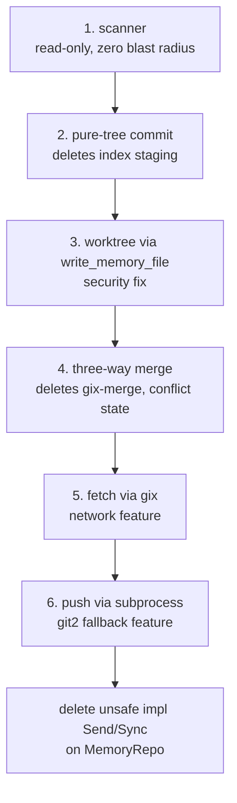

# Design

## Context

`pali` is one crate, shipped as a single binary inside a VSIX. Today the
crate's git usage splits across five modules:

| Module | Owns | gix-ready today? |
| --- | --- | --- |
| `git_read.rs` | read-side HEAD, status, untracked, tree/blob diff, merge-base | yes |
| `repo.rs` | init, index staging, commit, checkout/reset, fetch, merge, push, credential callbacks | no |
| `scanner.rs` | `Repository::open`, `head_commit`, `commit_messages`, `list_paths`, `blame_lines` | no |
| `error.rs` | `MemoryError::Git(#[from] git2::Error)` and `Gix(String)` | partial |

`git2` carries `default-features = false` with the `ssh`, `https`, and
`vendored-openssl` features. It is the **only** crate that pulls in
vendored OpenSSL (ADR-0023). The migration removes that vendored build.

Verified facts for gix 0.90.0 (crate-status.md, 2026-11-04):

| Capability | Upstream status |
| --- | --- |
| clone, fetch, ls-refs, commit, status, blob/tree diffing, merge-base, worktree streaming | implemented |
| checkout an index of files | implemented |
| **push** (send-pack, receive-pack, report-status, sideband, delete-refs, push-options, atomic) | **not implemented** |
| merge workflow orchestration / persist `MERGE_HEAD`/`MERGE_MSG`/`MERGE_MODE` | not implemented |
| checkout/switch/restore/reset | not implemented |
| `gix-ssh` (native transport, host-key, ssh-config, agent/key/password) | not implemented |
| `gix-index` add/remove entries; tree from index | not implemented |
| `gix-worktree-state` apply tree/index changes for reset/switch/restore/stash | not implemented |
| `gix-merge` | rewrite pending: maintainer note, "too insane now" |
| `gix-fetchhead` parse/write FETCH_HEAD | not implemented |

`gix` 0.90.0 ships 58 feature flags, 34 default. There is no push feature.
The crate currently opts into `["revision", "sha1", "status"]` only; `sha1`
is mandatory. Network features (`blocking-network-client`,
`blocking-http-transport-reqwest-rust-tls`) are opt-in.

## Goals / Non-Goals

**Goals:**

- Delete `vendored-openssl` from the dependency tree.
- Eliminate the hand-written `unsafe impl Send`/`Sync` on `MemoryRepo`
  (`repo.rs:259-260`) by confining `gix::Remote` to inside `spawn_blocking`.
- Replace the index-based commit and the merge orchestration with tree-based
  equivalents that do not depend on the unchecked capabilities.
- Preserve observable behavior across `save`/`read`/`list`/`move`/`delete`/
  `push`/`pull`/`merge` for every existing memory store.

**Non-Goals:**

- Pure-Rust SSH for push. `gix-ssh` is entirely unchecked; the migration
  defers to a subprocess or git2 fallback.
- Keeping gix's `merge` feature. The maintainer's own note is the
  justification for writing our three-way tree selection instead.
- Adopting `gix-worktree-state` reset/switch/restore semantics. pali
  materializes the worktree through its own writer instead.
- Reorganizing the broader error taxonomy beyond the two git variants.

## Decisions

### D-1: Pure-tree commit, no index

The cleanest way to dodge `gix-index`'s missing add/remove is to stop
needing them. A save becomes:

```text
save_memory(path, content)
  base  = read HEAD tree T0 (unborn HEAD -> empty tree)
  blob  = write_object(content)
  T1    = T0 updated: insert(path -> blob), prune empty parents
  commit = write_commit(parent = HEAD, tree = T1)
  compare_and_swap(HEAD, expected = T0_commit, new = commit)
  .git/index = regenerate_index(T1)   # for git CLI compat only
```

This deletes `index_from_head`, `stage_add`, `stage_remove`, `commit_index`
and makes save idempotent by construction. `write_memory_tree` produces T1;
`regenerate_index` keeps the on-disk `.git/index` consistent so a developer
running `git status` by hand sees what they expect. The CAS at step 5 is what
the new mutex replaces.

### D-2: Three-way tree selection, no gix-merge and no MERGE_HEAD

pali's conflict rule is already last-writer-wins by `updated_at` (ADR-0007).
That's all a memory store needs; line-level merge is meaningless because each
memory is one whole file.

```text
merge(ours, theirs, base) per path:
  ours == theirs -> keep
  ours == base   -> take theirs
  theirs == base -> take ours
  else           -> newer updated_at wins, ties -> ours
```

Because the rule is total — every path resolves, no conflict marker, no
manual resolution — there is no need to persist `MERGE_HEAD`,
`MERGE_MSG`, or `MERGE_MODE`, and no need to call `gix-merge` at all. This
deletes `resolve_conflicts_by_recency` (`repo.rs:1075`), `conflict_remove`,
and `cleanup_state`; a merge is one tree write. `MemoryError::PushRejected`
continues to be the surface for any genuine divergence the rule cannot
resolve.

### D-3: Worktree through `write_memory_file`, never `checkout_head(force)`

`checkout_head(force)` (`repo.rs:1470`) is a security hole the migration
should close: it bypasses `assert_within_root`, the symlink walk, the
`O_NOFOLLOW` probe, and `atomic_write`. Materializing files from the
newly-written tree through the same `write_memory_file` used by every save
restores defense in depth and removes the last `CheckoutBuilder` use.

### D-4: Migration order = risk order

```text
1. scanner (read-only, low blast radius)
2. pure-tree commit (deletes staging code; no network touched)
3. worktree materialization (security fix)
4. three-way merge (deletes gix-merge + conflict state)
5. network init/fetch (gix network client)
6. push (subprocess or git2 fallback)
```

Each step ships with a green nextest, preserves observable behavior, and is
revertable on its own. Step 6 is the only place the public surface changes
shape, so it lands last.

### D-5: Push = subprocess, git2 fallback behind a feature

Push is the hard blocker. Rather than block the migration,
`push-via-subprocess` defines the primary path:

```text
git push --porcelain --atomic <url> <ref>
```

Porcelain output is parseable and stable across git versions; `--atomic`
gives the all-or-nothing property the current `push_update_reference`
callback (`repo.rs:729`) provides. `push-fallback` is a Cargo feature; a
distro package manager that strips the git binary loses push, no other
functionality. The fallback also means a future `gix` push is a one-feature
swap.

### D-6: Feature gate and TLS posture post-migration

```toml
[dependencies]
gix = { version = "0.90", default-features = false, features = ["revision", "sha1", "status"] }
git2 = { version = "0.21", default-features = false, features = ["ssh", "https"], optional = true }

[features]
default = ["push-fallback"]
network = ["gix/blocking-network-client", "gix/blocking-http-transport-reqwest-rust-tls"]
push-fallback = ["dep:git2", "git2/ssh", "git2/https", "git2/vendored-openssl"]
```

`network` and `push-fallback` are additive: a build enabling neither has no
OpenSSL at all; enabling `network` pulls rustls; enabling `push-fallback`
pulls git2 with vendored OpenSSL for the fallback only. This is the design
that lets the binary with no network client have no OpenSSL, satisfying the
primary goal.

### D-7: Differential parity, not unit parity

`git_read.rs` already has `gix_untracked_enumeration_matches_libgit2`. This
change extends that harness to commit / merge / checkout / restore / blame /
commit-subject / list-paths: each test runs the same mutation through
git2 and through gix and asserts the resulting tree, ref, and worktree bytes
match. The harness is the verification gate for steps 1–5; the existing
in-process handler tests (`tower::ServiceExt::oneshot`) remain the gate at
the API boundary.

## Risks / Trade-offs

### R-1: A custom merge is a permanent liability

The gix maintainer's own note on `gix-merge` — that the whole logic needs to
be rewritten so it can be proven correct, with way more states than tested —
is exactly why a small total rule beats adopting it. The risk is that a
future pali feature (e.g., multi-writer editing of one memory) needs line
merging, which pali has explicitly opted not to support. Mitigation:
`conflicts_resolved` semantics must be read in `repo_router.rs`/`server.rs`
before step 4 so no consumer assumes "conflict means user intervention."

### R-2: Subprocess push widens the attack surface

`git push --porcelain` reaches the system `git` binary, which may invoke
`credential.helper`, `url.<base>.insteadOf`, and `core.sshCommand` /
`ProxyCommand`. pali cannot control that environment from inside the
subprocess. Mitigations: set the subprocess `GIT_CONFIG_GLOBAL=/dev/null`,
`GIT_CONFIG_SYSTEM=/dev/null`, and
`GIT_CONFIG_COUNT=1`+`GIT_CONFIG_KEY_0=credential.helper`+
`GIT_CONFIG_VALUE_0=` to disable inherited credential helpers (this matches
the existing `normalize_git_token` posture, ADR-0004). `redact_url` already
covers log leakage, and is unit-tested for the new URL form.

### R-3: Losing libgit2's classification at the API boundary

`MemoryError::Gix(String)` is weaker than `Git(#[from] git2::Error)` for
consumers that pattern-matched `ErrorCode::NotFound` or
`ErrorCode::NonFastforward`. The new `push-via-subprocess` and
`local-only-repo` specs both rely on those classifications. Mitigations:
map from gix's error kind at the seam; add a variant on demand as concrete
consumers demand it, and only when an Accepted ADR covers the new variant's
contract.

### R-4: `gix::Remote` is `!Send`

`Remote` cannot cross a thread boundary, so the code that builds it has to
live entirely inside `spawn_blocking`. The compiler enforces this, and after
the migration removes `MemoryRepo`'s `unsafe impl Send`/`Sync` (`repo.rs:259-260`)
the codebase can no longer hand a non-`Sync` value to `tokio::spawn`.

### R-5: Differential parity is O(2) build time

Parity tests hold git2 around for the duration of the migration. The
fallback should be removed once push over gix exists and one release cycle
of subprocess-push has shipped without incident.

### R-6: MSRV pressure

`rust-version = "1.99"`, edition 2024. gix 0.90's MSRV must be verified at
step 1; if it exceeds 1.99, the change is blocked at the CI feature check
and the migration waits for the next gix release.

### R-7: Deployment matrix and SSH posture

The gix network client (step 5) must speak HTTPS to GitHub with a token from
the OS keyring (ADR-0010). rustls provides HTTPS without OpenSSL; if a
deployment needs OpenSSL, it ships only inside `push-fallback` for the
git2 path. SSH posture is deferred to the operator (k8s image per ADR-0014,
bare Windows per `fix-ssh-ed25519-windows`) and is not made worse by this
change.

## Migration order recap



Every step lands with a focused nextest, the differential parity harness,
and an ADR for the structural eliminations in D-1 through D-3.

## Verification

- `cargo nextest run --workspace --no-fail-fast` at every step.
- `cargo tree -e features -i paligrep -e no-dev` (correct name:
  `cargo tree -e features -i pali`) at step 1 to record the baseline, and at
  step 5/6 to confirm `vendored-openssl` is gone with `default`, present and
  scoped under `push-fallback` (or gone entirely once step 6 is reverted).
- `cargo deny check` after any dependency change (ADR-0017 MSRV, ADR-0023
  TLS constraints).
- Default features and `--all-features` per `AGENTS.md`; the
  `network` and `push-fallback` matrix mirrors CI.
- An operator-side rehearsal: clone an existing real memory repo with git2,
  write a few hundred commits, then replay the same operations with the
  migrated binary and diff the resulting worktree, tree, refs, and packed
  objects.

## Open questions

1. **Does the OpenSSL-deletion prize justify the push parse layer?**
   Pending the `cargo tree -e features` baseline. If vendored OpenSSL is
   smaller in the binary than the push parser, the prize is smaller than the
   council estimated.
2. **Is the SSH `ProxyCommand` environment hard-enough against in the
   subprocess model?** Re-confirm `GIT_CONFIG_GLOBAL=/dev/null` semantics
   against the operator's deployment (k8s image per ADR-0014 vs bare Windows).
3. **What are `conflicts_resolved`'s consumers today?** Read
   `repo_router.rs` and `server.rs` before step 4 so the no-marker rule does
   not silently break a UI affordance.
